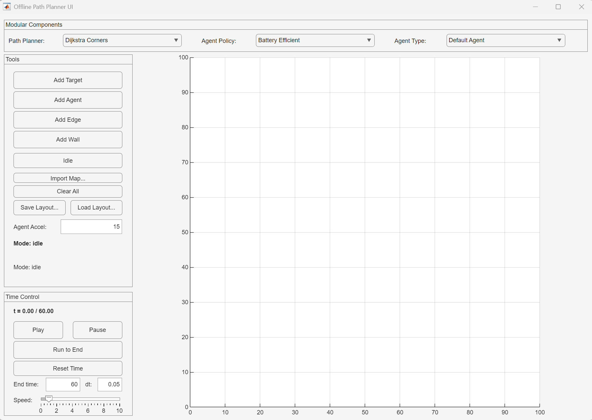
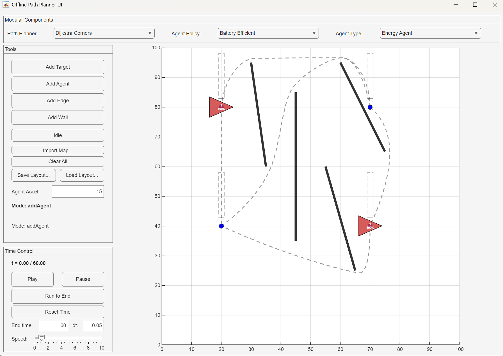
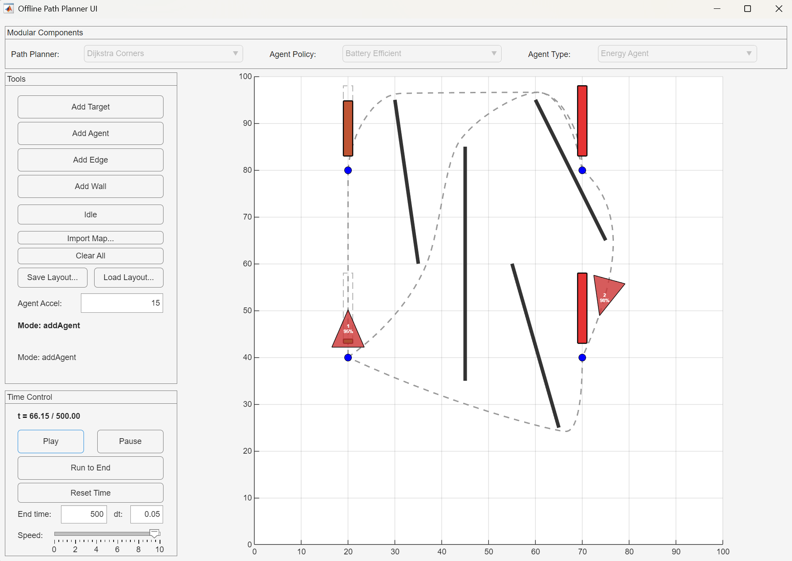
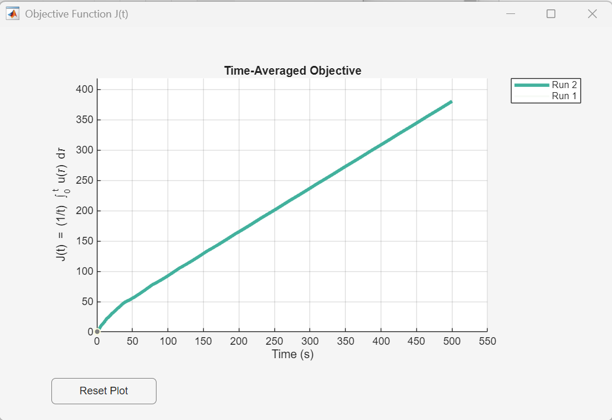

# MultiAgentSimulator

A MATLAB simulator for experimenting with multi-agent path planning, navigation policies, and agent behavior. Agents move between targets on a user-drawn graph, avoiding walls, while an objective function tracks how well the swarm covers the environment over time.

The project is designed around three **modular areas** so new algorithms can be dropped in and compared side-by-side from the UI:

- **Path Planner** — how a path between two targets is computed (e.g. shortest distance, energy-efficient turning).
- **Agent Policy** — how an agent decides which target to go to next.
- **Agent Type** — the agent class itself (its dynamics, state, energy model, rendering, etc.).

## Examples

### Main UI
The application on launch — Modular Components bar on top, Tools panel on the left, Time Control below, canvas on the right.



### Building a scenario
Targets, edges, and walls drawn on the canvas before running the simulation.



### Simulation running
Agents following their paths mid-simulation. The Modular Components dropdowns are locked while the sim is active.



### Objective plot
The objective function `J(t)` tracked over the course of a run.



## Running the project

1. Open MATLAB and set the working directory to the repo root (`MultiAgentSimulator`).
2. In the Command Window, run:
   ```matlab
   runMainUI
   ```
   This adds all subfolders to the path and opens the UI.
3. Use the dropdowns in the **Tools** panel to pick a Path Planner, Agent Policy, Agent Type, and Uncertainty mode. These can only be changed while the simulation is **not** running.
4. Use the **Tools** panel to add targets, agents, edges, and walls (**Agent Speed** sets the maximum speed of the next agents you place). Use the **Time Control** panel to play/pause the simulation.

## Target uncertainty and defaults

Each target's uncertainty follows `dR_i/dt = (A_i - B_i N_i) v_i`, where `N_i` is the number of agents at the target and `v_i` keeps `R_i >= 0`. The defaults match the simulator paper:

| Parameter | Default |
|---|---|
| Uncertainty mode | `Static Uniform` (constant `A_i`) |
| Growth rate `A_i` | 1 for every target |
| Decay rate `B_i` (per agent) | 10 |
| Initial uncertainty `R_i(0)` | 0 |

The other modes are opt-in from the **Uncertainty** dropdown:
- `Static Priority Target` — target 1 grows at `A = 5`, the rest at their `A_i`.
- `Dynamic Uncertainty` — as above, plus periodic spikes: every target's rate jumps to `A_spike = 14` for 10 s every 250 s, staggered by 50 s from one target to the next. With `B = 10`, one agent cannot bring a spiking target down (`14 - 10 > 0`) but two can (`14 - 2*10 < 0`).

The experiment harness (`Experiments/runTrial`, `Experiments/trialDefaults.m`) sets its own uncertainty parameters for every trial (by default `Dynamic Uncertainty` with `B = 20` and `A_spike = 28`, the same one-agent/two-agent balance), so its results do not depend on these GUI defaults.

## Layout files

**Save Layout...** / **Load Layout...** (and `ScenarioModel.exportLayout` / `importLayout`) use a `.mat` file holding a struct `s`:

| Field | Meaning |
|---|---|
| `targets` | `n x 2` target positions |
| `edges` | `m x 2` target index pairs |
| `walls` | `k x 4` wall segments `[x1 y1 x2 y2]` |
| `agentStarts` | start target index of each agent |
| `agentSpeed` | maximum speed of each agent (or one value for all) |
| `uncertaintyMode` | one of the modes above |
| `A`, `B`, `R0` | per-target `A_i`, `B_i`, `R_i(0)` (`n x 1`, or one value for all) |

Only `targets` and `edges` are required, so files saved by older versions still load: missing fields keep the defaults above and no agents are placed. Loaded agents use the Agent Type selected in the dropdown. `runTrial` ignores stored agents and places its own from the `AgentStarts` parameter.

`Configurations/ReportLayout.mat` is the reference scenario of the simulator paper (Stevens Smart Lab, background `LabLayout.png`): 11 targets, 10 edges, 3 walls, and 5 agents at speed 15 starting on targets **1, 6, 2, 3, 5** (agent 1 on target 1, agent 2 on target 6, and so on), in `Static Uniform` mode with `A = 1`, `B = 10`, `R(0) = 0`.

## Smoke test

Run from the repo root before opening a pull request:
```
matlab -batch "addpath(genpath(pwd)); smokeTest"
```
`tests/smokeTest.m` checks the defaults and the layout file round trip, then runs every registered policy x path planner x agent type for 20 s on `ReportLayout.mat` and checks that each run finishes with a finite objective `J`. It prints one line per check and exits with an error if any check fails (about 20 s). New components registered in `ComponentRegistry` are picked up automatically.

`tests/guiTest.m` drives the real GUI with MATLAB's App Testing Framework: it loads `ReportLayout.mat` over the lab background and runs to the end, plays, pauses and resets, saves, clears and reloads a layout, and builds a small scenario by clicking. It needs a display; the windows open and close on screen while it runs (about 45 s):
```
matlab -batch "addpath(genpath(pwd)); assertSuccess(runtests('guiTest'))"
```
Screenshots of each stage are written to `results/gui/` (git-ignored).

## Adding a new modular class

Each area has a dedicated folder under `Components/`. Creating a new algorithm takes two steps:

1. Create a new `.m` class file in the matching folder.
2. Register it in `Components/ComponentRegistry.m` — this makes it appear in the UI dropdown automatically.

### 1. New Path Planner

Folder: `Components/PathPlanner/`

Create a class that inherits from `PathPlanner` and implements `plan`:

```matlab
classdef MyPlanner < PathPlanner
    methods
        function path = plan(obj, pStart, pEnd, walls, bounds)
            % Return an Nx2 matrix of [x y] waypoints from pStart to pEnd.
            path = [pStart; pEnd];
        end
    end
end
```

Register it in `ComponentRegistry.m`:
```matlab
obj.pathPlanners('My Planner') = @() MyPlanner();
```

### 2. New Agent Policy

Folder: `Components/AgentPolicy/`

Create a class with a `plan` method that returns a move command struct:

```matlab
classdef MyPolicy < handle
    methods
        function cmd = plan(obj, agent, model, adj, curIdx, simTime)
            cmd = struct();
            nbrs = find(adj(curIdx, :));
            if isempty(nbrs), return; end
            cmd.kind = "move";
            cmd.targetIdx = nbrs(1);          % index of the target to move to
            cmd.dwellSeconds = 0.5;           % optional: wait at the current target before leaving
        end
    end
end
```

Returning `struct()` (no `kind`) leaves the agent where it is; it asks again on the next step. Instead of `dwellSeconds`, a policy may set `agent.dwellRemaining` itself, as the RHC policies do.

Register it:
```matlab
obj.policies('My Policy') = @() MyPolicy();
```

### 3. New Agent Type

Folder: `Components/AgentTypes/`

Subclass `Agent` and implement `update(dt)`:

```matlab
classdef MyAgent < Agent
    methods
        function obj = MyAgent(index, position, maxSpeed)
            obj@Agent(index, position, maxSpeed);
        end

        function update(obj, dt)
            % Move obj.state along obj.path (N x 2 waypoints from the path planner) for dt
            % seconds; set obj.path = [] once the last waypoint is reached.
        end
    end
end
```

`Agent` holds the shared state (`state`, a `KinematicState`; `path`; `dwellRemaining`; the start target) and implements `resetToInitial`, `draw`, and `updateVisuals`. Override `resetToInitial` (calling `resetToInitial@Agent(obj)` first) to reset extra state, or `label` to change the text drawn on the agent. `LinearAgent` is the simplest complete example, `DefaultAgent` adds PD control with acceleration limits, and `EnergyAgent` adds a battery. Agents of different types can be mixed in one scenario.

Register it:
```matlab
obj.agentTypes('My Agent') = @(idx, pos, sp) MyAgent(idx, pos, sp);
```

That's it — restart `runMainUI` and the new component will appear in its dropdown.
